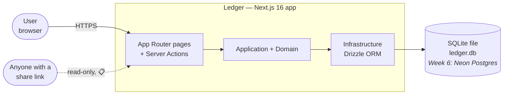
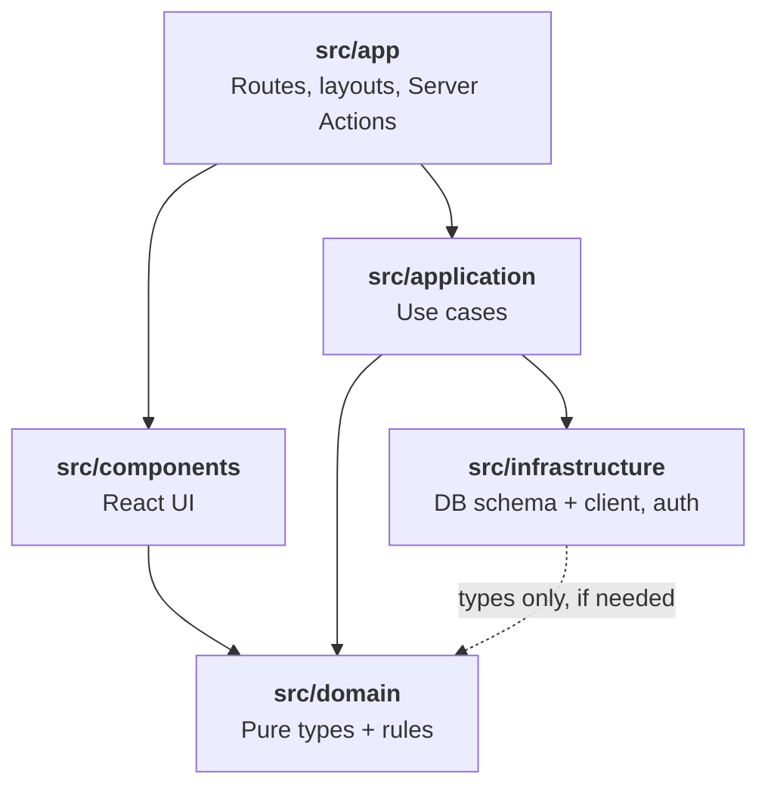
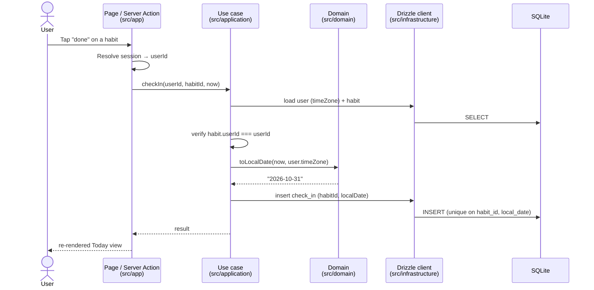
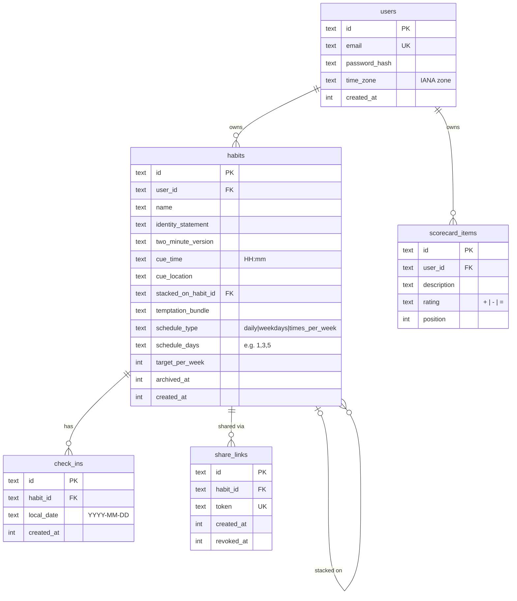
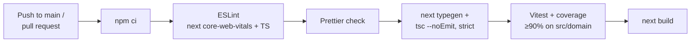

# Ledger — System Architecture

Ledger is a habit tracker built on James Clear's Four Laws of Behavior Change: make it **obvious**, **attractive**, **easy** and **satisfying**. This document describes how the system is put together. It covers what exists today (end of Week 1) and the shape it is meant to grow into over the roadmap in [README.md](README.md).

> **Status legend:** ✅ implemented · 🚧 scaffolded / partial · 📋 planned

---

## 1. Architectural style

**A layered modular monolith in a single Next.js app** (the README calls it "Architecture A").

- **One deployable.** UI, server logic and data access live in one Next.js process. There are no separate services, queues or APIs to run.
- **Layers inside `src/`.** Dependencies point one way, inward toward a pure domain core.
- **Server-first.** Pages render as React Server Components, and writes go through Server Actions. No public REST/GraphQL API is planned.

This keeps a solo project cheap to run while keeping the business rules (streaks, schedules, "at risk") isolated and testable in milliseconds.

## 2. System context



| Actor / system | Role                                                                          | Status |
| -------------- | ----------------------------------------------------------------------------- | ------ |
| User           | Signs in, defines habits, checks in daily, views streaks/heatmap/scorecard    | 📋     |
| Share viewer   | Opens a tokenised link to view one habit's progress (backed by `share_links`) | 📋     |
| SQLite         | Local persistence via `better-sqlite3`, file path from `DATABASE_URL`         | ✅     |
| Neon Postgres  | Production database once deployed to Vercel                                   | 📋     |

## 3. Layers and the dependency rule



**The one rule:** `src/domain` imports nothing from `app/`, `application/` or `infrastructure/`, and it imports no framework code. Its only runtime dependency is `date-fns-tz`.

| Layer              | Path                                                     | Responsibility                                                                                                                                       | Status                   |
| ------------------ | -------------------------------------------------------- | ---------------------------------------------------------------------------------------------------------------------------------------------------- | ------------------------ |
| **Presentation**   | [src/app/](src/app/), [src/components/](src/components/) | Routing, rendering, form handling via Server Actions, auth gating. No business rules.                                                                | 🚧 Empty Today view only |
| **Application**    | [src/application/](src/application/)                     | Use cases: `createHabit`, `checkIn`, `undoCheckIn`, `getDashboard`. Orchestrates domain + persistence, maps rows ↔ domain types, enforces ownership. | 📋 Placeholder           |
| **Domain**         | [src/domain/](src/domain/)                               | Framework-free types and pure functions: date math, `isScheduled`, `currentStreak`, `bestStreak`, `isAtRisk`.                                        | 🚧 Types + date helpers  |
| **Infrastructure** | [src/infrastructure/](src/infrastructure/)               | Drizzle schema, DB client, (later) auth configuration.                                                                                               | ✅ Schema + client       |

## 4. Request lifecycle (target design)

No use case exists yet. The flow below is the intended path for a check-in, and every write is meant to follow the same shape.



Reads like `getDashboard` follow the same shape. The use case loads habits and check-ins, maps them into domain `Habit` / `CheckIn` values, and passes them to pure domain functions that compute streaks and at-risk flags.

## 5. Domain model

Defined in [src/domain/types.ts](src/domain/types.ts).

```ts
type LocalDate = string; // "YYYY-MM-DD" in the user's time zone

type Schedule =
  | { type: "daily" }
  | { type: "weekdays"; days: number[] } // ISO 1 = Mon … 7 = Sun
  | { type: "times_per_week"; target: number };

interface Habit {
  id;
  name;
  identityStatement;
  twoMinuteVersion;
  schedule;
  stackedOnHabitId?;
  createdOn: LocalDate;
}
interface CheckIn {
  habitId;
  localDate: LocalDate;
}
```

Domain functions:

| Function                         | Purpose                                                     | Status |
| -------------------------------- | ----------------------------------------------------------- | ------ |
| `toLocalDate(instant, timeZone)` | Instant → calendar date in an IANA zone                     | ✅     |
| `isoWeekday(date)`               | `LocalDate` → 1 (Mon) … 7 (Sun)                             | ✅     |
| `addDays(date, n)`               | Calendar arithmetic, DST-safe (computed in UTC)             | ✅     |
| `isScheduled`                    | Is a habit due on a given date?                             | 📋 W2  |
| `currentStreak` / `bestStreak`   | Streak calculation honouring the schedule                   | 📋 W2  |
| `isAtRisk`                       | "Never miss twice": flag a habit missed on its last due day | 📋 W2  |

### Time model (key design decision)

Every "today" is computed **in the user's own time zone**. The schema comments reference this as NFR-04.

- `users.time_zone` stores an IANA zone (e.g. `America/New_York`).
- A check-in records a **`local_date` string**, not a timestamp. A check-in at 23:30 in New York counts for that New York day, whatever the date is in UTC.
- Date arithmetic on `LocalDate` runs in UTC, so DST transitions never skip or repeat a day. Tests in [src/domain/dates.test.ts](src/domain/dates.test.ts) cover this.
- Instants become dates in exactly one place: `toLocalDate`, called from the application layer.

## 6. Data model

Source of truth: [src/infrastructure/db/schema.ts](src/infrastructure/db/schema.ts). Generated SQL: [drizzle/0000_init.sql](drizzle/0000_init.sql).



**Conventions**

- IDs are `text` UUIDs generated in app code (`crypto.randomUUID()`).
- Timestamps are Unix seconds (`integer`, `mode: "timestamp"`), defaulted by `unixepoch()`.
- Soft delete for habits (`archived_at`) and share links (`revoked_at`). Hard deletes cascade from `users` → `habits` → `check_ins` / `share_links`.
- `check_ins(habit_id, local_date)` is **unique**, so a habit can be checked in at most once per day. This makes check-ins idempotent at the database level.
- `stacked_on_habit_id` uses `ON DELETE SET NULL`, so deleting an anchor habit doesn't delete the habits stacked on it.

**How the Four Laws map to columns**

| Law                    | Feature                   | Column(s)                                           | Req. ID    |
| ---------------------- | ------------------------- | --------------------------------------------------- | ---------- |
| 1 · Make it obvious    | Implementation intention  | `cue_time`, `cue_location`                          | FR-04      |
| 1 · Make it obvious    | Habit stacking            | `stacked_on_habit_id`                               | FR-05      |
| 1 · Make it obvious    | Habit scorecard           | `scorecard_items`                                   | FR-11      |
| 2 · Make it attractive | Identity-based habits     | `identity_statement`                                | FR-03      |
| 2 · Make it attractive | Temptation bundling       | `temptation_bundle`                                 | FR-12 (P2) |
| 3 · Make it easy       | Two-minute rule           | `two_minute_version`                                | FR-06      |
| 4 · Make it satisfying | Streaks, heatmap, sharing | `check_ins`, `share_links`                          | —          |
| —                      | Flexible schedules        | `schedule_type`, `schedule_days`, `target_per_week` | FR-08      |

### Persistence and migrations

- **Client** ([src/infrastructure/db/client.ts](src/infrastructure/db/client.ts)): a module-level singleton `better-sqlite3` connection wrapped by Drizzle, with `journal_mode = WAL` and `foreign_keys = ON`. SQLite doesn't enforce foreign keys unless that pragma is set.
- **Migrations** are generated, not hand-written:

```text
edit schema.ts ──► npm run db:generate ──► drizzle/NNNN_*.sql + meta/ ──► npm run db:migrate ──► ledger.db
```

Configured in [drizzle.config.ts](drizzle.config.ts) (dialect `sqlite`, reads `DATABASE_URL`).

## 7. Presentation layer

- **Next.js 16.4 App Router** with React 19.3. The root layout is [src/app/layout.tsx](src/app/layout.tsx). The only route is `/` → [src/app/page.tsx](src/app/page.tsx), the Today view with an empty state.
- **[next.config.ts](next.config.ts)** turns on `cacheComponents` and `partialPrefetching`. These change how rendering and data caching work compared with older Next.js versions. Read the bundled docs in `node_modules/next/dist/docs/` before writing the first data-fetching page (see [AGENTS.md](AGENTS.md)).
- **Styling:** Tailwind CSS v4 loaded through `@tailwindcss/turbopack` as a Turbopack CSS loader. Theme tokens (`--background`, `--foreground`, `--font-sans`) live in [src/app/globals.css](src/app/globals.css), with a `prefers-color-scheme: dark` override.
- **Validation:** `zod` is a dependency but not used yet. It will validate Server Action input at the presentation/application boundary.
- **Path alias:** `@/*` → `src/*`, used by both TypeScript and Vitest.

## 8. Quality gates and tooling



Defined in [.github/workflows/ci.yml](.github/workflows/ci.yml) (Ubuntu, Node 22).

- **Tests:** Vitest picks up `src/**/*.test.ts`. Coverage is measured **only on `src/domain`** (excluding `types.ts`), with lines/functions/branches thresholds of 90%. The domain is where correctness matters most and where tests are cheapest.
- **Type safety:** `strict: true`. Drizzle infers row types (`User`, `HabitRow`, `CheckInRow`) from the schema.

## 9. Configuration

| Variable       | Default     | Used by                          | Notes                                        |
| -------------- | ----------- | -------------------------------- | -------------------------------------------- |
| `DATABASE_URL` | `ledger.db` | `client.ts`, `drizzle.config.ts` | SQLite file path now; Postgres URL in Week 6 |

`.env*` files and `*.db` files are git-ignored. `.env.example` is the template.

## 10. Deployment

| Environment | Runtime               | Database                      | Status |
| ----------- | --------------------- | ----------------------------- | ------ |
| Local dev   | `next dev` on Node 22 | SQLite file (`ledger.db`)     | ✅     |
| CI          | GitHub Actions        | none (no DB-backed tests yet) | ✅     |
| Production  | Vercel                | Neon serverless Postgres      | 📋 W6  |

## 11. Roadmap through the layers

| Week | Milestone                   | Layers touched                                            |
| ---- | --------------------------- | --------------------------------------------------------- |
| 1 ✅ | Foundations                 | Infrastructure (schema, client), CI, empty `app/`         |
| 2    | Domain core                 | `domain/`: `isScheduled`, streaks, `isAtRisk`             |
| 3    | Auth + habit CRUD           | `infrastructure/` (auth), `application/`, `app/`          |
| 4    | Check-ins + Today view      | `application/` (`checkIn`, `getDashboard`), `components/` |
| 5    | Streaks, heatmap, scorecard | `domain/` + `components/`                                 |
| 6    | Deploy                      | `infrastructure/` (Postgres), deployment config           |

## 12. Open questions and known risks

These came out of reading the code. They don't block Week 2 but should be settled before the week that depends on them.

1. **The Postgres switch is bigger than swapping `client.ts`.** The client comment suggests a one-file change, but `schema.ts` imports `drizzle-orm/sqlite-core` (`sqliteTable`, SQLite `unixepoch()` defaults, integer timestamps), `drizzle.config.ts` sets `dialect: "sqlite"`, and the migrations in `drizzle/` are SQLite SQL. Week 6 means porting the schema to `pg-core`, starting a fresh migration history and replacing the `better-sqlite3` driver. A local SQLite file also can't persist on Vercel's serverless runtime, so the switch is required, not optional. Writing every use case with `await` from the start keeps the application layer portable, because the SQLite driver can run synchronously and the Neon driver cannot.
2. **The dependency rule is a convention, not a check.** Nothing stops `src/domain` from importing `@/infrastructure/...`. An ESLint `no-restricted-imports` rule scoped to `src/domain/**` would make CI enforce it.
3. **Row ↔ domain mapping needs a home.** The DB stores schedules as three flat nullable columns (`schedule_type`, `schedule_days` as a CSV string, `target_per_week`), while the domain uses a discriminated union. Nothing at the DB level stops invalid combinations (e.g. `weekdays` with no days). Likewise, `habits.created_at` is a timestamp while the domain expects `createdOn: LocalDate`, which needs the user's time zone to convert. Put one mapper in `application/` (or `infrastructure/`) and validate with `zod` on write.
4. **Ownership is indirect for check-ins and share links.** `check_ins` and `share_links` have no `user_id` column, so every use case must authorise through `habits.user_id` before reading or writing them.
5. **Habit stacking can form cycles.** `stacked_on_habit_id` is a free self-reference. Prevent A → B → A in the application layer.
6. **The `times_per_week` week boundary isn't defined yet.** `isoWeekday` suggests Monday-start ISO weeks. Decide this explicitly in Week 2, because it affects streak results.
7. **Untracked requirement IDs.** Schema comments cite FR-03…FR-12 and NFR-04, but the requirements document isn't in the repo. Consider adding it (e.g. `docs/requirements.md`) so the IDs resolve.
8. **`share_links` isn't on the roadmap.** The table exists, but no week mentions sharing. Either schedule it or note it as post-v1.
